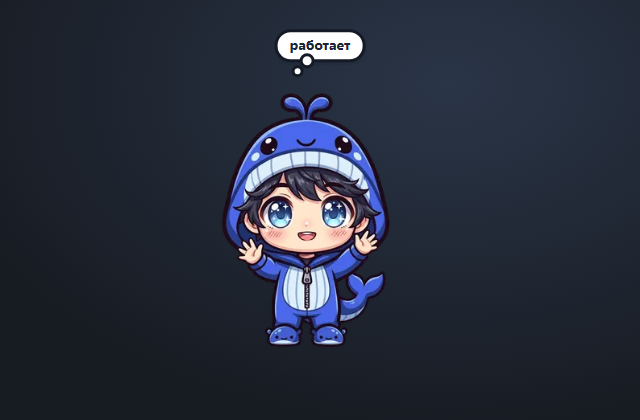

# dsh-pajama-whale

A tiny person in a blue-whale onesie who lives in the DeepSeek Harness window.
Drag him around: there is no gravity and no bounce, so a throw sends him
straight into a window edge, where he sticks, squashed flat, until you pull him
off. In his spare time he blinks, wags his tail, laughs, sleeps and shows a
thought cloud with what the agent is doing.



## Install

```sh
dsh plugin --profile web add github:lubenkov/dsh-pajama-whale#v0.3.1
```

Replace `web` with your profile name (for example `desktop`). The `#v0.3.1`
suffix pins the install to the tagged release instead of the moving `master`.
Or install the current working copy with the plugin manager by pointing it at
this directory.

## What it does

- **Drag and throw.** Pointer drag with capture; release with speed to throw.
  No gravity, no bounces.
- **Squash against the window edge.** Four sprite directions (`up`, `right`,
  `left`, `down`) with 8 hand-drawn frames each. The edge he touches stays put,
  and the frame is chosen by how far the pointer overshoots the wall.
- **Emotions.** While idle he only blinks (4 frames) or wags his tail
  (12 frames). A completed turn plays `joy` once, and waking up from sleep
  plays `yawn`.
- **Agent poses.** While the agent works he switches to the `thinking` (20
  frames) or `working` (12 frames) animation instead of a text status.
- **Sleep.** After a minute without agent activity and without the cursor
  touching him, he falls asleep with the looping `sleepy` animation and wakes on
  any interaction or a new turn.
- **Thought cloud.** Above his head, in priority order:
  - `?` — the agent waits for approval or an answer;
  - `! error` — the last turn failed;
  - `take a break?` — after 50 minutes of continuous work (up to 3 minutes of
    pause still counts as continuous);
  - `context N%` — context pressure above 80% (crossing 80% also plays a short
    `surprised` animation);
  - `hmm…` — the only idle thought, once every 70–160 s for 3.6 s.
  Hover the cloud to see context pressure; a click on the pet shows the same
  context for 5 seconds; clicking the cloud opens the watched session.
- **Follows the DSH language.** English and Chinese dictionaries ship with the
  plugin and follow Settings → Language; anything else falls back to English.
- **Cheap when idle.** Breathing runs in short 3.4 s sessions every 25–40 s and
  stops completely when the window is hidden, so the compositor stays asleep.
- **Remembers its place.** Position, the wall he is stuck to and the squash
  depth are stored in `localStorage` and clamped on window resize.

The pet only occupies the frame-wide overlay slot (`shell.overlay`) and never
blocks clicks outside its own body.

## Development

Requirements: Node 20+, Python 3 with Pillow (only for rebuilding sprites).
Tested DSH versions and the fallback behaviour are listed in
[COMPATIBILITY.md](COMPATIBILITY.md).

```sh
# 1. pack the source frames into WebP strips (needs assets/sprites/)
python tools/build-sheets.py

# 2. inline the strips into the browser module
node tools/build-client.mjs

# 3. validate the package, sheets, locales and size budget
node tests/validate.mjs
```

`assets/sprites/` is the generated artwork pack and is not committed because of
its size (about 64 MB). The committed `assets/build/*.webp` strips are the
packed result, and `client.js` is the built artifact that ships to users.

Source of truth:

| Path | Role |
|---|---|
| `src/client.src.js` | readable client source with sheet placeholders |
| `client.js` | built module with inlined WebP data URIs |
| `assets/build/*.webp` | packed sprite sheets |
| `tools/build-sheets.py` | packer (PNG frames -> WebP strips) |
| `tools/build-client.mjs` | inliner (strips -> `client.js`) |
| `index.js` | empty Host half; the pet is browser-side only |

## Artwork

The character and the sprite animations were generated with an external image
model and cleaned up for this pack. See `LICENSE` for the code license; the
artwork ships with the plugin.

## License

MIT
